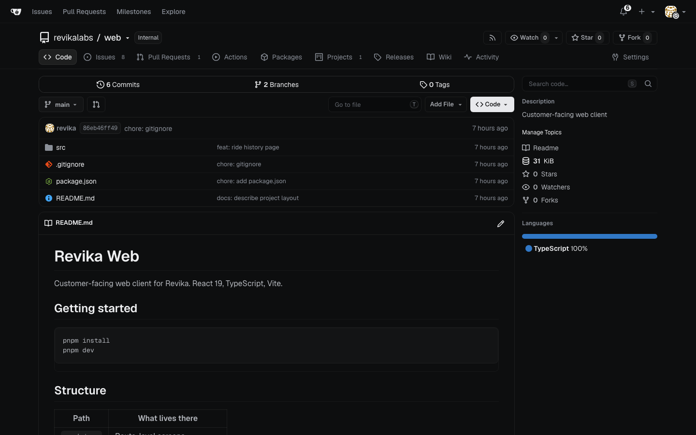
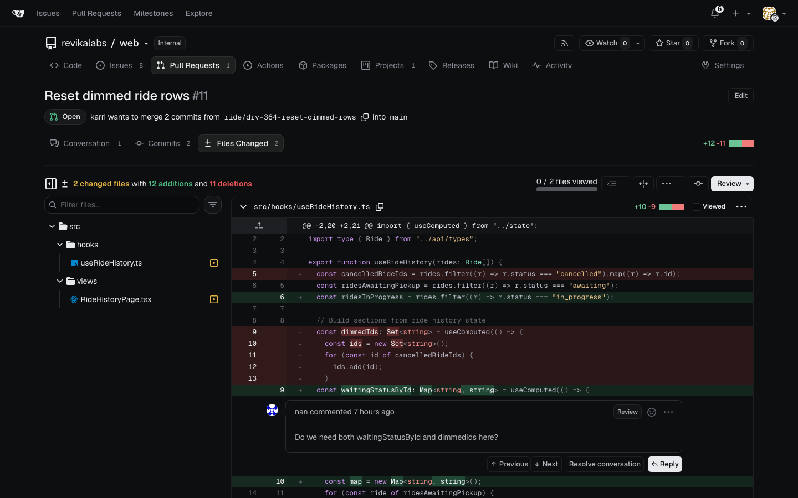
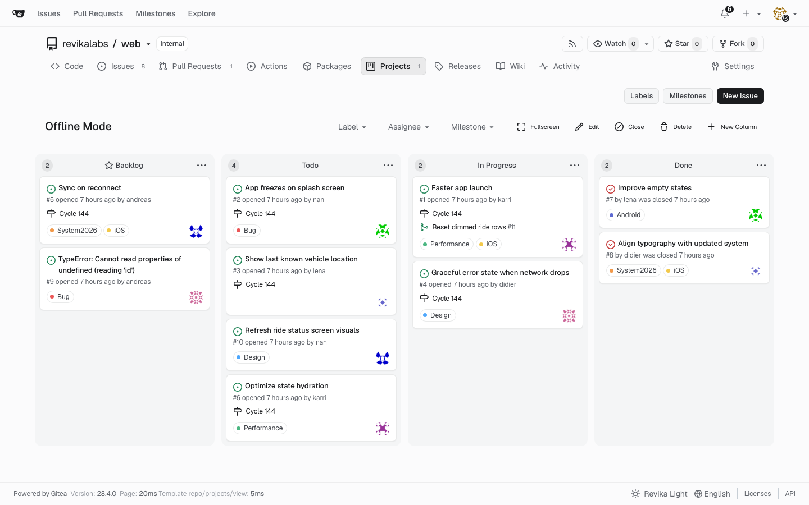
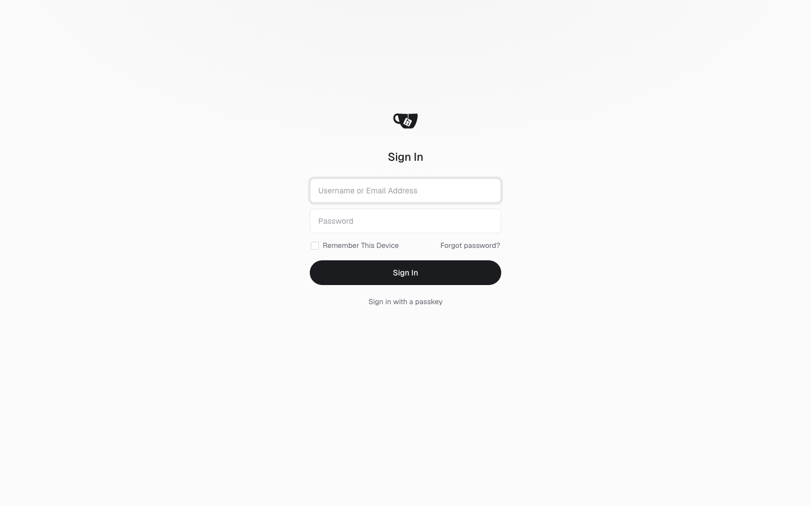

# Revika theme for Gitea

Gitea 28.4 theme in the Revika style: compact density, neutral surfaces, colour only on status marks. Ships Revika Dark, Revika Light and Revika Auto (follows the OS setting).

## Layout

| Path | What lives there |
| --- | --- |
| `src/tokens/gitea-*.base.css` | Upstream Gitea colour variables, copied verbatim |
| `src/tokens/{dark,light}.css` | Revika primitives (`--rv-*`) and their mapping onto Gitea variables |
| `src/components/*.css` | Component styles shared by all schemes |
| `src/fonts/` | Geist and Geist Mono (SIL OFL 1.1) |
| `templates/` | Overridden Gitea templates, mounted as `custom/templates` |
| `upstream/templates/` | Untouched v28.4.0 originals of every overridden template, for diffing on Gitea upgrades |
| `dist/` | Built themes, committed so Gitea can use them without a build step |
| `docs/screenshots/` | Committed page captures in both schemes; `npm run shots` regenerates them into `shots/` and syncs this folder |
| `dev/` | Local Gitea, seed data, screenshot script |

## Develop

```sh
npm install && npx playwright install chromium-headless-shell
./scripts/build.sh
docker compose -f dev/docker-compose.yml up -d
python3 dev/seed.py          # user revika / revika-dev-pass
npm run shots                # build + both schemes into shots/, synced to docs/screenshots/{dark,light}/
SCHEME=light node dev/shots.mjs  # only light, into shots/light/
node dev/probe.mjs           # computed geometry/styles of key elements
node dev/audit.mjs           # overflow, edges, radii, button heights, WCAG contrast (SCHEME=light too)
```

Gitea runs on http://localhost:3300 in `RUN_MODE=dev`, so template edits apply on reload. After a CSS change rebuild and hard-refresh the page.

`npm run check` fails when the committed `dist/` is out of date. Reset the instance with `docker compose -f dev/docker-compose.yml down -v`, then start and seed again.

## Screenshots

Dark scheme:




Light scheme:




More pages: [issues](docs/screenshots/dark/issues.png) · [issue](docs/screenshots/dark/issue.png) · [pull request](docs/screenshots/dark/pr.png) · [dashboard](docs/screenshots/dark/dashboard.png) · [pulls](docs/screenshots/dark/pulls.png) · [organization](docs/screenshots/dark/org.png) · [settings](docs/screenshots/dark/settings.png) · [2FA](docs/screenshots/dark/twofa.png) · [branch menu](docs/screenshots/dark/branch-menu.png) · [PR sidebar](docs/screenshots/dark/pr-sidebar.png) — the same set for the light scheme lives in [`docs/screenshots/light/`](docs/screenshots/light/).

## Install

1. Copy `dist/theme-revika-*.css` to `$GITEA_CUSTOM/public/assets/css/` and `src/fonts/*.woff2` to `$GITEA_CUSTOM/public/assets/fonts/`.
2. Copy `templates/` to `$GITEA_CUSTOM/templates/` (Gitea 28.4.x only; they replace the sign-in and 2FA pages for all themes).
3. Add `revika-dark,revika-light,revika-auto` to `[ui] THEMES` in `app.ini` and restart Gitea. The theme list is cached until restart, so new themes do not appear in the menu before that.
